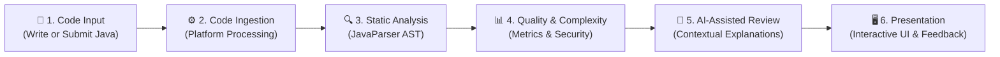

<div align="center">

# 🚀 AI-Powered Code Review & Quality Analysis Platform

**An intelligent code review platform designed to help developers analyze, understand, and improve their Java code through static analysis, quality metrics, and AI-assisted feedback.**

<p align="center">
  
  
  
  
  
  
</p>

[Overview](#-overview) • [Key Features](#-key-features) • [Languages](#-supported-programming-languages) • [How It Works](#-how-it-works) • [Tech Stack](#-technology-stack) • [Getting Started](#-getting-started) • [Documentation](#-documentation)

</div>

---

## 📖 Overview

The **AI-Powered Code Review & Quality Analysis Platform** aims to make code review more understandable, structured, and accessible.

It combines deterministic static code analysis with AI-assisted explanations to identify potential issues, evaluate code quality, and provide actionable improvement suggestions.

> [!NOTE]  
> Currently, the platform supports **Java programming language only**. Support for Python and C++ is planned as part of future development.

---

## ✨ Key Features

- **🔍 Java Code Analysis:** Analyze Java source code using JavaParser-based static analysis.
- **📊 Code Quality Assessment:** Evaluate code using measurable quality indicators.
- **⚡ Complexity Analysis:** Identify cyclomatic complexity, nesting depth, and other code complexity indicators.
- **💡 Maintainability Insights:** Highlight code patterns that may affect readability and maintainability.
- **🛡️ Security Checks:** Identify selected potentially insecure coding patterns.
- **🤖 AI-Assisted Code Review:** Provide contextual explanations and recommendations to help developers understand potential issues.
- **✨ Code Improvement Suggestions:** Offer guidance for writing cleaner and more maintainable code.
- **🎯 Practice Mode:** Supports a learning-oriented coding experience.
- **📝 Free-form Code Review Mode:** Allows users to submit their own Java code for review.
- **💻 Interactive Code Editor:** Provides a code editing experience using Monaco Editor.

---

## 🌐 Supported Programming Languages

### 🟢 Currently Supported

 

**Java**

> The current implementation is focused on Java code analysis and review.

### 🔵 Planned / Upcoming

  

- **Python**
- **C++**

> We are actively planning to expand the platform's language support. Python and C++ support will be introduced in upcoming development phases.

---

## ⚙️ How It Works



1. **Write or Submit:** The user writes or submits Java source code.
2. **Code Ingestion:** The platform processes the submitted code.
3. **Static Analysis:** Static analysis identifies potential code issues.
4. **Metrics Evaluation:** Code quality and complexity indicators are evaluated.
5. **AI Review:** AI-assisted review provides additional explanations and recommendations.
6. **Results Delivery:** The results are presented through the platform's interface.

---

## 🛠️ Technology Stack

| Layer | Technologies & Tools | Key Role / Details |
| :--- | :--- | :--- |
| **Backend** | `Java 21`<br>`Spring Boot 3.3.5` | Modern Java runtime, REST APIs, and application framework |
| **AST Analysis** | `JavaParser Core 3.26.3` | Deterministic Abstract Syntax Tree parsing & static rule checks |
| **Databases** | `H2 Database`<br>`PostgreSQL` | Fast in-memory development & production-ready persistent storage |
| **Testing** | `JUnit 5`<br>`Mockito` | Comprehensive unit and integration test suites |
| **Frontend UI** | `React.js`<br>`Vite` | Reactive component architecture and high-performance bundler |
| **Code Editor** | `Monaco Editor` | Rich in-browser IDE experience with Java syntax highlighting |
| **Styling & UX** | `Vanilla CSS`<br>`Lucide Icons` | Developer-centric dark design system & crisp iconography |

---

## 📁 Project Structure

```text
AI-Code-Review-Assistant/
│
├── code-review-backend/
│   ├── src/
│   ├── pom.xml
│   └── ...
│
├── frontend/
│   ├── src/
│   ├── package.json
│   └── ...
│
├── docs/
│   ├── PRODUCT_VISION.md
│   ├── ARCHITECTURE.md
│   ├── ANALYSIS_ENGINE.md
│   ├── EXECUTION_ENGINE.md
│   ├── AI_REVIEW.md
│   ├── SECURITY.md
│   └── ROADMAP.md
│
└── README.md
```

---

## 🚀 Getting Started

### Prerequisites

Make sure you have the following installed:

- **Java 21**
- **Maven**
- **Node.js** and **npm**
- **Git**

### 1. Clone the Repository

```bash
git clone https://github.com/Shriyanshi025/AI-Code-Review-Assistant.git
cd AI-Code-Review-Assistant
```

### 2. Start the Backend

```bash
cd code-review-backend
mvn clean test
mvn spring-boot:run
```

Backend URL:

```text
http://localhost:8080
```

H2 Console (when enabled):

```text
http://localhost:8080/h2-console
```

### 3. Start the Frontend

Open another terminal:

```bash
cd frontend
npm install
npm run dev
```

Frontend URL:

```text
http://localhost:5173
```

To create a production build:

```bash
npm run build
```

---

## 📚 Documentation

For more information about the project, refer to:

| Document | Description |
| :--- | :--- |
| 📖 [Product Vision](docs/PRODUCT_VISION.md) | Product philosophy, core user workflows, and vision |
| 🏗️ [System Architecture](docs/ARCHITECTURE.md) | Component architecture and system interactions |
| 🔍 [Analysis Engine](docs/ANALYSIS_ENGINE.md) | Java AST parsing rules and static analysis specifications |
| ⚡ [Execution Engine](docs/EXECUTION_ENGINE.md) | Isolated safe code execution architecture |
| 🤖 [AI Review](docs/AI_REVIEW.md) | AI semantic review, reasoning, and hint generation |
| 🛡️ [Security](docs/SECURITY.md) | Security policy, untrusted code isolation, and guidelines |
| 🗺️ [Project Roadmap](docs/ROADMAP.md) | Release milestones and future language expansion plans |

---

## 🔮 Future Scope

The platform will continue to evolve with planned enhancements, including:

- **🐍 Python Support:** Extend code analysis and review capabilities to Python.
- **⚡ C++ Support:** Introduce C++ code analysis and review.
- **🌐 Multi-language Architecture:** Expand the analysis framework to support additional programming languages.
- **🔬 Enhanced Static Analysis:** Improve code quality, complexity, and security analysis.
- **🤖 Advanced AI Review:** Enhance contextual explanations and code improvement recommendations.
- **🔌 Additional Integrations:** Explore integrations with development platforms and workflows.

---

## 🎯 Project Goal

> Our goal is to develop an intelligent and extensible code review platform that helps developers identify issues, understand their code better, and continuously improve software quality.

**Currently focused on Java. Expanding towards Python and C++ next.**
